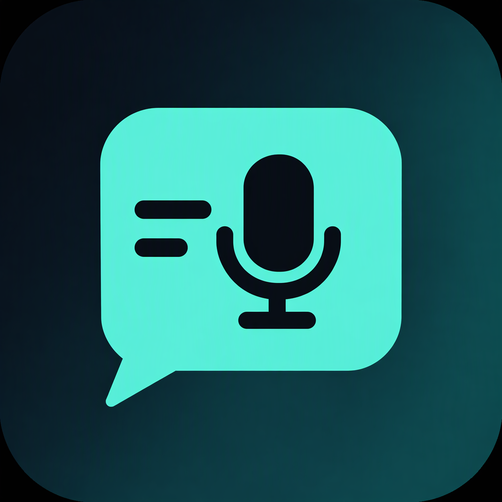

# FlowBubble



A permission-gated voice and vision layer for Android. A floating bubble holds the microphone; speak naturally and FlowBubble dictates clean text into the focused field, edits selected text, reads or acts on the screen, or runs short multi-step tasks in any app.

This repository is a working Android app (Kotlin, Jetpack Compose, custom overlay windows), not a mockup. It uses documented Android capabilities only: overlay windows, an accessibility service, MediaProjection screen capture with on-device OCR, a notification listener, a microphone foreground service, runtime permissions, intents, and a Quick Settings tile. There is no root, no hidden privilege escalation, and no attempt to bypass lock screens, authentication, or passwords.

## What is built

- Floating, draggable bubble above other apps with hold-to-talk, live transcript, and a Stop action in the ongoing notification.
- Hands-free wake phrase: say "Hello Bubble", then a command, with no touch at all. Listening pauses when the screen is off, so does the microphone. Outcomes and confirmation prompts are read aloud, and you can answer "yes" or "no"; silence never approves anything. It is off by default and has its own switch in Settings and the bubble menu.
- Dictation: speech is transcribed, filler words and repeated words are removed, punctuation and casing are applied, and the result is inserted at the caret. Insertions are verified against the focused field, and a short-lived Undo is offered.
- Inline editing: select text in any editable field that exposes accessibility selection, then hold the bubble and say "make this professional", "turn this into bullet points", "translate to Spanish", and similar. On-device rewrites work without a model; free-form edits use an optional OpenAI-compatible endpoint.
- Commands: open apps, set a timer or alarm, open the dialer, prepare a message draft, open an existing chat with a contact, open map directions, Do Not Disturb on/off (with optional duration, automatically reverted even if the app is restarted or the device reboots), taps by label or ordinal, scroll, back/home/recents, open Android settings, take a screenshot, play/pause media, read or clear notifications, type into the focused field, and search the current app or the web.
- Screen understanding: with per-session screen access, FlowBubble fuses Accessibility nodes with on-device ML Kit OCR. It can read the visible screen, find controls that accessibility hides, answer a question about the screen, or translate it. Frames stay in memory and are never written to disk.
- Short agent tasks: "open Chrome then search for weather", "tap the second result, then scroll down", "open Settings and search for display". A deterministic local planner handles the common chains; an optional AI planner can propose steps for unfamiliar screens. Every step is observed and verified, and the progress panel always offers Stop.
- Scroll to find: "scroll down until you see References", "find the pricing section by scrolling", or "scroll until you see Checkout and tap it". FlowBubble scrolls one step at a time, re-reads the screen, stops when the label appears (and taps it only when you asked), and reports honestly when the screen stops changing or the label is never found.
- Conversational follow-ups: after a dictation or a screen reading, "make it shorter", "make this professional", "turn that into bullet points", or "translate that to Spanish" reuse the text you just produced. "Undo that", "do that again", and "copy that" work on the last step. Follow-up memory lives in RAM only and is cleared when the bubble turns off.
- Smart screen actions: "what can I do here" scans the visible text for phone numbers, email addresses, links, and street addresses and offers buttons such as Call, Email, Open, or Map. Nothing runs until you tap a button, and Call still only opens the prefilled dialer.
- Voice routines: "save this as a routine called morning brief" (or "save routine check battery for run battery status"), then "run routine morning brief" from any app. Routines are stored on-device, capped at 20, listed in Settings with a delete confirmation, and replay through the normal confirmation gates.
- Direct OS controls: "flashlight"/"flashlight off", "volume up/down" (three steps), "set volume to 30 percent", "mute"/"unmute", and "battery". Flashlight and volume read the real system state back and say "requested" when Android accepts without confirming.
- Drafts, never sends: "draft an email to alex@example.com about the meeting" opens your mail app with the address and subject ready, and "add a calendar event called dentist" opens the event editor with the title. Both panels state plainly that you press Send or Save yourself.
- Notification access is explicit and bounded: FlowBubble keeps only notifications that arrive while it is connected, in memory (last 40), never reads notification history, and dismisses only notifications it recorded after a confirmation.
- Message drafts never send themselves. FlowBubble resolves a contact, shows the exact message, and opens WhatsApp or WhatsApp Business (or the SMS composer) with the text ready, using an international (E.164) number so the draft reaches the right chat. The user presses Send.
- Existing conversations open directly: "go to chat of Pranav", "open chat with Priya on WhatsApp", "WhatsApp Arjun". Contacts are resolved as people (every saved number attached, mobile first), an exact name is never listed twice, and a name that matches several people asks you to choose. Android has no "find this person's chat" API, so FlowBubble uses each app's published deep link, then requires two independent facts before reporting success: the chat app came to the front, and the person's name is visible in it. A missing app, a contact with no number, or a saved national number that cannot be made international each produce their own honest panel with a usable fallback.
- Hindi and Hinglish commands: with the language set to हिन्दी or English (India), the core requests work in Devanagari or romanised form — "यूट्यूब खोलो", "क्रोम में मौसम खोजो", "स्क्रीन पढ़ो", "नीचे स्क्रॉल करो", "सेटिंग्स पर टैप करो", "प्रणव को कॉल करो", "प्रणव से चैट करो", "प्रणव को मैसेज भेजो कि …", "पाँच मिनट का टाइमर लगाओ", "टॉर्च चालू करो", "आवाज़ बढ़ाओ", "बैटरी बताओ". A spoken message body stays in its own script, and every rewritten phrase enters the same English grammar, safety gates, routing, and verification as an English command. Anything outside the fixed command set is still treated as dictation, not guessed at.
- A local activity history (last 100 summaries, on-device only) and a settings screen for the optional AI endpoint, AI planning, language, the speech engine, voice routines, and history.
- Permission onboarding that explains every capability and blocks features honestly when access is missing.
- One routing table decides what is possible before anything runs. `agent/CapabilityRouter.kt` maps every command to ready, gated (with the exact system switch and a button that opens that screen), or unsupported — so the panel, the history entry, and the settings prompt all agree about what was actually possible, and no half-configured action pretends to have worked.
- An explicit outcome vocabulary (`agent/Outcome.kt`): completed, partial, awaiting user, unsupported, failed. Agent chains carry a step-by-step execution trace, and a chain is only reported complete when every step has evidence the system actually observed. Steps that Android never confirms are listed as "not confirmed by the system".

## Requirements

- Windows, macOS, or Linux with Android Studio or a standalone Android SDK.
- JDK 21 to run Gradle (the app targets Java 17 bytecode).
- Android 8.0 (API 26) or newer, with Google speech recognition available. API 30+ is recommended: the accessibility screenshot action and media key control require it, and current Android versions show the system screen-capture consent flow. The bundled ML Kit text-recognition model works offline.
- `adb` for sideloading.

Android Studio writes `local.properties` with your SDK path the first time you open the project. It is gitignored and never committed.

## Build

```bash
export JAVA_HOME="/path/to/jdk-21"
./gradlew :app:assembleDebug
```

The APK is written to `app/build/outputs/apk/debug/FlowBubble-<version>-debug.apk`.

Run the unit tests:

```bash
./gradlew test
```

Install on a connected device or emulator:

```bash
adb install -r app/build/outputs/apk/debug/FlowBubble-1.0.0-debug.apk
```

## Release and CI

Pull requests and `main` run `.github/workflows/ci.yml`: JDK 21, Android 35 SDK, debug build, unit tests, and uploaded artifacts. Pushing a `v*` tag runs `.github/workflows/release.yml`, which refuses a tag that does not match `versionName`, builds the release APK, verifies it with `apksigner`, and only then publishes the GitHub Release with `FlowBubble-<version>-release.apk` attached.

Release signing stays out of git: `keystore/` and `keystore.properties` are gitignored. Without them the release build still compiles and the artifact is named `…-release-unsigned.apk` so it can never be mistaken for a deliverable. [docs/RELEASE.md](docs/RELEASE.md) covers the branch flow, keystore setup, CI secrets, and how to switch a device between debug and release channels.

## First-run setup

Open FlowBubble and work through the Setup tab. Each permission is requested through Android's own screen.

| Capability | Required | Why it is needed | How FlowBubble behaves without it |
|---|---|---|---|
| Microphone | Yes | Records only while the bubble is held; audio goes to the device speech recognizer | The bubble shows a setup card instead of listening |
| Display over other apps | Yes | Renders the bubble, transcript pill, and result cards above the current app | The service refuses to start |
| Accessibility service | Yes | Reads the focused editable field and visible controls; inserts or replaces text; performs requested taps, scrolls, and navigation | Dictation, editing, taps, scrolling, and screen reading are blocked with an explanation |
| Notifications | Recommended | Keeps the microphone session visible and provides a permanent Stop control | The session is less visible; the bubble still works |
| Contacts | Recommended | Resolves names for message and call commands | Message commands ask you to grant contacts; calling still works with a spoken number |
| Do Not Disturb access | Optional | Android requires it before any app may change interruption filters | DND commands open the access screen |
| Battery optimization exemption | Optional | Keeps the bubble service alive during long sessions | The system may stop the service when the app is idle |
| Notification access | Optional | Enables "read my notifications" and "clear all notifications" | Notification commands explain that access is off and link to the system screen |

Accessibility is a sensitive permission. The service reads only what a command needs: the focused editable node, a selection, visible labels for the requested UI action, or screen text when you explicitly ask to read it. It skips fields marked as passwords. It does not log screen content, audio, or credentials.

Screen access is separate and stronger. Tapping "Turn on screen access" opens Android's own MediaProjection consent dialog each session. On Android 14 and newer the dialog lets you choose a single app or the entire screen; FlowBubble needs the entire screen for cross-app vision, but the choice stays yours. The notification listener keeps a small in-memory buffer; it never reads historical notifications and never persists them.

### Sideloading and Google Play

This build is intended for developer testing and sideloading. Google Play restricts general-purpose automation through the Accessibility API, and an accessibility tool intended for people with disabilities has separate policy requirements. Do not publish this app to Play without reviewing the current policy and, for real accessibility distribution, without the user research and safeguards the policy expects.

## Using the bubble

1. Turn on the bubble from Home or the Quick Settings tile.
2. Hold the bubble until it starts glowing, speak, then release. The live transcript appears above the bubble.
3. FlowBubble decides the route:
   - A supported command runs directly.
   - Free text with no selection is cleaned and inserted at the caret.
   - Free text with a selection is treated as an editing instruction.
   - A command that needs a switch you have not opened stops there: the panel names the switch, says what was not done, and offers **Open settings** for exactly that screen. Nothing runs partially on the way.
4. Drag the bubble quickly to move it. Tap it for a menu with setup, status, hands-free, and a turn-off switch.

## Hands-free

Turn on **Hands-free** in Settings, or tap the bubble and choose **Turn on hands-free**. The bubble keeps one recognizer turn open while the screen is on and waits for the wake phrase.

1. Say **"Hello Bubble"**. It answers "Yes?" and listens for one command. You can also say the command in the same breath: "Hello Bubble, open Gmail."
2. The command runs through exactly the same router, safety gates, and verification as a held-bubble turn. The outcome is spoken ("Opened Gmail", "I stopped because…"), and the bubble returns to waiting for the wake phrase.
3. Say **"close"**, **"cancel"**, or **"go back"** to dismiss whatever is showing. **"Tap …"**, **"type …"**, **"scroll …"**, and short agent chains work the same way they do in a held turn, so compose screens, dialogs, and any visible button can be driven without touching the screen.
4. When an action needs confirmation, FlowBubble reads the panel aloud and listens for **yes** or **no** (Hindi "haan" and "nahi" also work). Tapping the panel still works. Silence, a timeout, or a closed panel never counts as approval.
5. While a panel is open, wake listening pauses; closing it resumes. Turning the screen off stops the microphone; turning it on resumes listening.

Hands-free is off by default. It listens only while the screen is on and the switch is on, the ongoing notification always shows that state, and turning the bubble off ends it along with the microphone service. Continuous listening costs battery, and Android shows its microphone indicator while the service holds the microphone.

Example commands:

- "Open YouTube."
- "Draft a message to Priya saying I'll be there in ten minutes."
- "Go to chat of Pranav." / "Chat with Priya on WhatsApp." / "Open WhatsApp Business chat with Arjun."
- "Set a timer for twelve minutes."
- "Set an alarm for 7:30 am."
- "Turn on Do Not Disturb for one hour."
- "Navigate to the nearest petrol station."
- "Call mom."
- "Tap the second result."
- "Scroll down twice."
- "Read this screen." (Shows on-screen text; no network is involved.)
- "What can I do here?" (Finds phone numbers, emails, links, and addresses on screen and offers buttons.)
- "Scroll down until you see References." / "Find pricing by scrolling." / "Scroll until you see Checkout and tap it."
- "Make it shorter." / "Undo that." / "Do that again." / "Copy that." (Follow-ups on your last dictation or screen reading.)
- "Save this as a routine called morning brief." / "Run routine morning brief." / "Delete routine morning brief."
- "Flashlight." / "Flashlight off." / "Volume up." / "Set volume to 30 percent." / "Mute." / "Battery."
- "Draft an email to alex@example.com about the meeting." / "Add a calendar event called dentist."
- "Ask what is the total on this screen." / "Translate this screen to Spanish." (Requires the optional AI model; FlowBubble asks before sending visible text.)
- "Read my notifications." / "Clear all notifications." (Requires notification access; clearing always asks first.)
- "Take a screenshot." / "Play." / "Pause." / "Next track."
- "Type hi there." (Into the focused field; searching uses the field's submit action.)
- "Search this app for budget." / "Search the web for train times." / "Search Flipkart for running shoes." (The last one opens the app, waits for it to come forward, and only types once a search field is found.)
- "Long press the first message." / "Press and hold the blue button for 2 seconds." (Opens the app's own context menu, then say "Tap Pin".)
- "Open the menu." / "Tap more options." (Finds the overflow control, including unlabelled three-dot icons in the app bar.)
- "Swipe left." / "Swipe right twice." (For carousels, tabs, and sideways lists.)
- "Select all." / "Copy." / "Paste." / "Clear the field." (Field and selection control in any app.)
- "Dismiss." / "Close this popup." (Presses a close or cancel control, or asks before using back. It never presses Allow, OK, Confirm, Buy, or Delete for you.)
- "Close." / "Cancel it." (Dismisses the current dialog, keyboard, or activity with the back action. Inside a FlowBubble confirmation, "no" or "cancel" denies it instead.)
- "Open Chrome then search for weather." / "Tap the second result, then scroll down." (Short verified agent chains.)
- With text selected: "Make this professional." / "Turn this into bullet points." / "Translate this to Spanish."

Spoken numbers work for timers and Do Not Disturb durations ("ten minutes", "one hour", "twenty five minutes"). Alarms use digits or "7:30 am"; speech recognition normally formats those as numbers.

In Hindi (Devanagari or Hinglish), the same core requests work:

- "यूट्यूब खोलो" / "youtube kholo"
- "क्रोम में मौसम खोजो" / "chrome mein mausam khojo" / "मौसम खोजो"
- "स्क्रीन पढ़ो" / "नीचे स्क्रॉल करो" / "सेटिंग्स पर टैप करो"
- "प्रणव को कॉल करो" / "प्रणव से चैट करो" / "प्रणव को मैसेज भेजो कि मैं देर से आऊंगा"
- "पाँच मिनट का टाइमर लगाओ" / "टॉर्च चालू करो" / "आवाज़ बढ़ाओ" / "बैटरी बताओ" / "पीछे जाओ"

## Speech recognition

Settings has a Speech engine card with three choices:

| Choice | Behaviour |
|---|---|
| Automatic (default) | Uses the on-device ML Kit recognizer when its model is ready for the current language, otherwise the system recognizer, and says which one it picked |
| On-device model | Refuses to start until the model is installed, then never leaves the device |
| System recognizer | Always uses the device's own recognizer (Google app or OEM equivalent) |

The card shows the real download state for the selected language — ready, installing, not available on this device, or failed — with a **Check again** probe. When the model is installable it offers **Download the on-device model**, with live byte progress. FlowBubble never starts that download by itself; the button is the consent, and the size is shown first (the offline model is a multi-hundred-megabyte download).

Two things the bundled recognizer does not give back is handled after transcription, not by claiming more than the engine knows:

- **No confidence and no alternatives.** `PhraseResolver` re-scores the heard phrase against the vocabulary of installed app labels and known aliases, using a typo distance. A clear match acts; a near miss asks "did you mean YouTube?" instead of opening nothing; a phrase with nowhere to go is never silently dropped.
- **Misheard app names that arrive as dictation.** If free text has no focused field to write into, FlowBubble treats it as a likely app request and offers the app rather than reporting a failed insertion.

Hindi arrives as Devanagari when the recognizer language is set to हिन्दी. `voice/Devanagari.kt` transliterates names for contact matching, and `voice/HindiCommands.kt` rewrites the core verb forms into the English grammar before parsing. The rewrite is a fixed pattern table, not a translation engine: app names come back through a small borrowed-word table (यूट्यूब → youtube), a search query or message body keeps the script you spoke, and a phrase that matches no command stays dictation. The command set covered today is listed under example commands; everything else is intentionally not guessed.

## Optional AI model

Settings accepts any OpenAI-compatible `chat/completions` endpoint, an API key, and a model name. It powers:

- cleanup of dictated text when the on-device rules are not enough,
- free-form editing such as translation or tone changes,
- answering a question about the screen or translating it, after you explicitly confirm sending the visible text,
- "AI planning for free-form tasks": when the local planner cannot map a multi-step request, the model proposes a short JSON action plan (open, tap, type, scroll, back, wait, ask) that FlowBubble validates and executes with the same safety gates.

The key is stored in the app's private SharedPreferences on the device. Use a restricted key and a local endpoint if the content is sensitive. No audio is sent to the AI endpoint, and no screenshot image is sent: screen features send only the visible text you approved, and the panel shows the endpoint and character count first.

## Safety behavior

- No messages, posts, purchases, or deletions are completed without a visible confirmation panel and the user's own answer: a tap, or a spoken yes when hands-free is on. A prompt that is ignored, times out, or is closed is a no.
- Password fields are never read or written. OCR is skipped while a password field is focused, credential-looking labels are refused, and apps that expose selection unpredictably get a text re-check before replacement (the result is copied instead when the field changed).
- Taps on risky labels (send, pay, delete, call, allow, install, dismiss, discard) require a confirmation panel with the label and reason — including a direct "tap send" command, not only agent steps. For a risky tap FlowBubble resolves the target only against actual controls, never against field text that merely contains the word, and the confirmation names the exact control it will press. Credential labels are blocked outright, and so are sign-in, payment, and CAPTCHA or "not a robot" prompts — FlowBubble will not work through a lock screen or a human check. A confirmation that is never answered does not become a silent "yes".
- Labels are matched the way people speak them: "&" reads as "and", punctuation and hyphens are ignored ("Network & internet" answers to "network and internet", "Wi-Fi" to "wifi"), and Devanagari vowel marks stay part of their letters instead of splitting words. Screen labels that only expose a content description are still found, so icon-only buttons such as Send can be named and gated.
- A field's placeholder is not treated as typed text. When a composer shows its hint after clearing, FlowBubble reads the value against the hint, so a successful clear or type is confirmed rather than misreported as left-over text.
- "Dismiss" and "close this" only press a control whose label really is close, cancel, skip, got it, or back. If the only buttons are Allow, OK, Confirm, Send, Delete, Buy, or Sign in, FlowBubble says so and stops; using the back gesture instead always asks first.
- A search that has to submit itself asks about the field's identity, not its contents: an address bar or a field whose hint says search, find, or look up is submitted as asked, while a field that could be a message composer is held for your approval. That approval appears only after the text is already visible in the field, so you are never asked to approve a submit you cannot inspect.
- Copy, paste, and select-all act on the focused field only. FlowBubble never reads the clipboard back, so it reports what the app accepted rather than what is stored, and it refuses to type or paste into a password field.
- Smart action buttons never run on their own; each button runs only after your tap, and Call opens the prefilled dialer instead of dialing. Email and calendar commands open a draft and never press Send or Save.
- A follow-up rewrite only replaces the text FlowBubble itself produced. Before writing, it re-reads the field; if you changed it in the meantime, the result is copied to the clipboard instead of overwriting your edit. Follow-up context is in-memory and dropped when the bubble is turned off.
- "Undo that" and "do that again" replay only ordinary commands. They refuse follow-ups, routine management, and anything that would need a fresh confirmation; a routine run re-parses each step through the same safety gates.
- Actions that Android does not confirm are reported as requested or unverified, never as successful. The agent verifies screen or package changes after each action and stops when a step provably did nothing.
- The ongoing notification always offers Stop, the agent progress panel has Stop, and turning off the bubble removes all overlay windows, stops the microphone service, and stops MediaProjection.
- Screen frames are captured at most every 170 ms, downscaled, held in memory, and dropped. Nothing is saved or uploaded. FlowBubble hides its own overlay before reading pixels so it never reads its own panels.
- Notification data is kept in a 40-entry in-memory ring buffer for the current listener session only. Dismissal is limited to notifications FlowBubble recorded and always follows a confirmation.
- History stores only a short command summary and status. Transcripts, audio, screen text, and notification content are not saved.
- The accessibility service skips its own package, ignores password nodes, caps screen traversal, and never sends screen text anywhere without an explicit confirmation that shows the endpoint.

## Known limitations

- This is not an unlimited autonomous agent. It runs short, verified chains from the local planner, plus optional AI-proposed plans that use a fixed action vocabulary. It does not loop indefinitely, spawn sub-agents, or recover from arbitrary UI dead ends; it stops with a reason instead.
- Screen capture is per-session by Android design. Access ends when the bubble is turned off, the device rotates in some OEM builds, or Android revokes the projection; FlowBubble reports that instead of pretending vision still works. Apps with `FLAG_SECURE` produce black frames, and FlowBubble says so.
- On Android 14+, the system consent dialog may default to sharing a single app. Cross-app vision needs "Entire screen"; FlowBubble cannot change that choice for you.
- OCR accuracy depends on text size, contrast, and language. It is fused with accessibility text, not a replacement for it. Games and fully custom-rendered surfaces may still expose nothing.
- Accessibility coverage varies by app. WebViews, Flutter, games, and custom-rendered surfaces may expose little or nothing. FlowBubble reports the failure instead of guessing with coordinate taps.
- On the API 35 emulator image, Android force-hides third-party overlay windows while the Settings app is in the foreground (`mPolicyVisibility=false`, `mForceHideNonSystemOverlayWindow=true` in `dumpsys window`). The bubble and its result card then stay invisible inside Settings even though the service is running and the command still executes. Debug and release builds behave identically, so this is a platform policy the app cannot override, not a build defect. The bubble draws normally over Chrome, Clock, the launcher, and the rest of the tested apps.
- Tap-by-label uses visible text or content descriptions and clicks the nearest clickable ancestor. Ambiguous screens may need a more specific label or an ordinal ("the second result").
- Long-press, swipe, and unlabelled-icon taps are dispatched gestures: Android accepts the gesture before the app reacts, so FlowBubble only claims it worked when the screen actually changed. Custom-rendered games and canvas UIs may accept the gesture and show nothing.
- Copy, select-all, and set-selection need Android 9 or newer and depend on the app exposing its text range; a field that reports no selection gets "asked the app to copy" rather than a success claim, and FlowBubble can never show clipboard contents.
- Notification reading only covers notifications posted while the listener is connected. Notification history is never read. Notification content can be hidden by the posting app.
- The screenshot command asks Android's accessibility service to capture the screen; the system saves it and FlowBubble cannot confirm the saved file or album.
- The current build does not implement a custom IME, VoiceInteractionService assistant role, or a wake word. Those are deliberate non-goals for this milestone.
- Timed Do Not Disturb is re-armed from a stored deadline on service start and after a reboot. If FlowBubble is uninstalled before that deadline, Android keeps the interruption filter as set.
- Timer and alarm commands depend on an installed clock app that accepts Android's standard intents; the panel reports that the request was sent, not that the clock app displayed a toast.
- Message resolution uses the name you speak, then the first matching number. If several contacts share a name, FlowBubble asks you to choose. Multi-word contact names require the "saying" form: "text Sarah Smith saying I'm late."
- Chat opening is limited to the apps with a documented deep link (WhatsApp, WhatsApp Business) and the standard SMS intent, and it addresses a *number*, not a server-side contact id. A contact saved without a country code cannot be linked unless Android can normalise it from the SIM's region; FlowBubble says so instead of opening a wrong chat. Apps with no published chat URI (Telegram without a username, Signal, Instagram) are reported as unsupported rather than guessed at. A chat that opens but does not show the contact's name is reported as unconfirmed, not as success.
- An Android update can disable an accessibility service; the app's status and every dependent action reflect that.
- Follow-ups cover the latest dictation or screen reading only. Restarting the bubble clears that memory, and a rewrite targets the field it was produced in; a different field is not touched.
- Scroll-to-find reads labels through accessibility, so a page that exposes no text cannot be searched. It scrolls at most six times per request by default and stops when the screen stops changing rather than looping.
- In-app search needs either a visible field or a control labelled "search". An app that hides search inside an overflow menu, or behind an unlabelled icon, gets an explicit failure rather than a blind tap. After tapping a search control FlowBubble waits for the field to actually appear, so a slow app still completes and a search screen with no field reports that instead of typing into whatever is focused.
- Flashlight state is observed through Android's torch callback; some devices accept the request without reporting state, and FlowBubble then says "requested" instead of claiming success. Devices without a flash camera get an explicit failure.
- Volume commands act on the media stream, not ring or alarm volume. The panel reports the exact level Android reports back.
- Email and calendar commands depend on an installed handler. A device with no configured mail account can still open the app but may stop at account setup; nothing is sent or saved by FlowBubble.
- Routines are capped at 20 and stored as text on-device. They replay ordinary commands only; a routine that depends on screen access still needs that consent for the session.
- The device speech recognizer determines language support, network use, and accuracy. Offline language packs help.
- Hindi command understanding is a fixed pattern set, not general Hindi NLU. It covers the commands listed above; other phrasings, multi-step Hindi chains ("… और …"), and Hindi voice routines are treated as dictation. App names rely on a borrowed-word table for popular apps plus transliteration, so an uncommon app spelled phonetically in Devanagari may need to be named in English. Contacts are matched after transliteration, so a contact saved only in Devanagari may need to be renamed or picked from the "did you mean" list. Search queries and message bodies keep the script you spoke, which is what makes Hindi search and Hindi messages work, but it also means an in-app search may need the app's own Hindi content to match.
- The on-device ML Kit recognizer ships without its weights. Android downloads them only when you press the button in Settings, the download is large, and some languages or devices report the model as unavailable. Automatic mode falls back to the system recognizer and says so on the first phrase.
- ML Kit returns no confidence score and no alternative transcripts, so "perfect understanding" is bounded by rescoring after the fact: only app names are in the vocabulary today, and a misheard word that resembles no app is treated as text, not corrected silently.
- A gate only opens the matching Android settings screen. FlowBubble cannot flip accessibility, notification-listener, DND, or consent switches itself; the user always taps.

## Project map

```
app/src/main/java/com/flowbubble/app/
  MainActivity.kt              Compose host, navigation, permission state
  core/                        preferences, permissions, history, notifications
  core/LastActionMemory.kt     in-memory follow-up context (never written to disk)
  core/RoutineStore.kt         on-device voice routines (SharedPreferences)
  core/TorchController.kt      flashlight control with state verification
  core/VolumeController.kt     media volume control and level reporting
  access/FlowAccessibilityService.kt
                               focused-field text, selection, insertion,
                               undo, taps, long-press, side swipe, overflow
                               menu, clipboard actions, scrolling, screen
                               text, screenshot
  access/SpokenText.kt         folds labels and spoken targets so & / - /
                               punctuation / Devanagari marks still match
  capture/                     MediaProjection foreground service, in-memory
                               frames, consent activity, capture state
  vision/                      ML Kit OCR, accessibility+OCR fusion, text
                               matching and scoring, screen model factory
  vision/SmartActions.kt       phone, email, link, and address detection with
                               button actions that require a user tap
  agent/                       deterministic planner, optional LLM planner,
                               step runner, safety policy, verification
  agent/CapabilityRouter.kt   pure route table: ready / gated / unsupported,
                               with the system switch each gate needs
  agent/Outcome.kt             shared outcome vocabulary and execution trace
  notifications/               notification listener, in-memory ring buffer
  overlay/BubbleView.kt        custom glowing bubble and gesture arbitration
  overlay/OverlayPanel.kt      programmatic result and confirmation cards
  voice/                       speech controller, command parser, text rules,
                               optional OpenAI-compatible client
  voice/TranscriptionEngine.kt engine abstraction and the automatic fallback
  voice/LocalSpeechEngine.kt   on-device ML Kit recognizer
  voice/LocalSpeechModel.kt    model status and user-triggered install
  voice/PhraseResolver.kt      post-transcription rescoring and did-you-mean
  voice/VocabularyProvider.kt  cached app labels used for rescoring
  voice/Devanagari.kt          Devanagari-to-Latin transliteration for matching
  voice/HindiCommands.kt       Hindi and Hinglish rewrite into the English grammar
  commands/                    app lookup, contact lookup, execution routes
  commands/AppAliases.kt       spoken-name and phonetic aliases for apps
  service/OverlayService.kt    foreground service, windows, session state
  service/FlowTileService.kt   Quick Settings tile
  ui/                          Compose screens and theme
app/src/main/res/drawable/ic_launcher_*.xml
                               adaptive icon: background, foreground, monochrome
app/src/test/java/...          parser, router, planner, vision, outcome, and
                               safety unit tests (no Android runtime needed)
.github/workflows/ci.yml       PR and main: debug build, unit tests, artifacts
.github/workflows/release.yml  v* tag: signed release APK, then the release
docs/RELEASE.md                branch flow, signing, CI secrets, channels
docs/assets/flowbubble-icon.png  brand icon for the README and releases
```

## Developer verification notes

For emulator testing only, ADB can grant some permissions directly. Normal users should use the Setup screen.

```bash
adb shell pm grant com.flowbubble.app android.permission.RECORD_AUDIO
adb shell pm grant com.flowbubble.app android.permission.POST_NOTIFICATIONS
adb shell pm grant com.flowbubble.app android.permission.READ_CONTACTS
adb shell appops set com.flowbubble.app SYSTEM_ALERT_WINDOW allow
adb shell settings put secure enabled_accessibility_services \
  com.flowbubble.app/com.flowbubble.app.access.FlowAccessibilityService
adb shell settings put secure accessibility_enabled 1
adb shell cmd notification allow_listener \
  com.flowbubble.app/com.flowbubble.app.notifications.FlowNotificationService
adb shell cmd notification allow_dnd com.flowbubble.app
```

Screen capture cannot be pre-granted over ADB. Start the bubble, tap "Turn on screen access", and accept Android's MediaProjection dialog (choose "Entire screen"). The grant is per session by design.

`settings put secure enabled_accessibility_services` can be reset by an emulator reboot or a package replace; re-apply it and the Setup screen will update within two seconds.

On an emulator, the host microphone is used by the guest. If speech recognition is unavailable, install or update the Google app and check that a speech recognition service is present.

### Device benchmark

`scripts/benchmark.mjs` runs a frozen set of 67 spoken tasks on a connected device and judges each one by the product's own history entry and foreground state, not by a screenshot. It covers app opening, web and in-app search, screen reading and control, system actions, communication drafts, routines, follow-ups, and two multi-step agent chains.

```bash
DEVICE=emulator-5554 node scripts/benchmark.mjs --install
DEVICE=emulator-5554 node scripts/benchmark.mjs --only apps
```

The runner installs the current debug APK, re-enables accessibility, starts the bubble, speaks each phrase through the debug transcript receiver, and polls history for the expected outcome. Confirmation tasks press Back after the panel appears, so a timeout never becomes a silent approval. Reports are written to `verify/benchmark/latest.md` and `latest.json`; each failure lists what the product actually recorded. Emulator-only failures (no flash unit, no notification access, no clock handler) are skipped or marked as such by the task definitions.

### Injecting a transcript without a microphone

Debug builds include a receiver that feeds text through the same route as a finished speech result. It lives only in `src/debug` and is not part of a release build.

```bash
adb shell "am broadcast -n com.flowbubble.app/.DebugSimulateReceiver \
  -a com.flowbubble.app.DEBUG_SIMULATE --es text 'set a timer for five minutes'"
```

Use the explicit `-n` component: implicit broadcasts to a background app are blocked on current Android versions. Keep the whole remote command in one pair of quotes so spaces survive ADB.

Some clock apps require `com.android.alarm.permission.SET_ALARM` before they accept timer and alarm intents. FlowBubble declares that permission in its manifest; if the device has no handler, the panel says so instead of claiming success.

